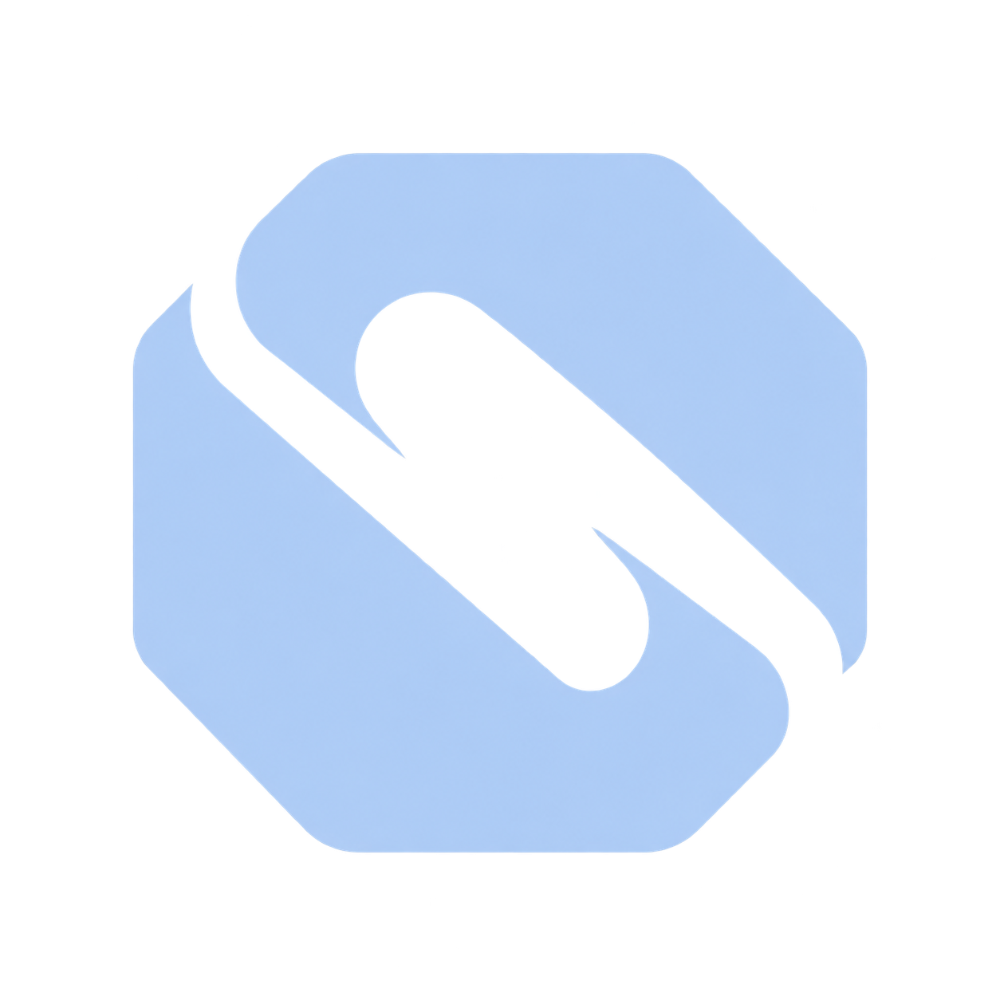
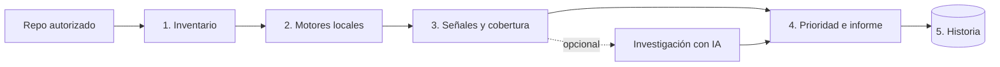
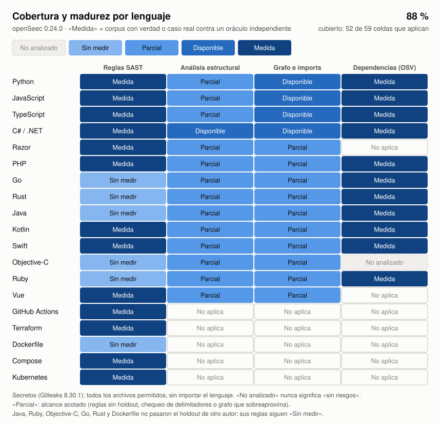
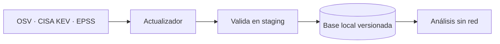
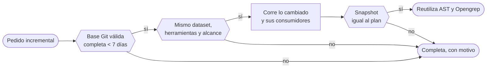
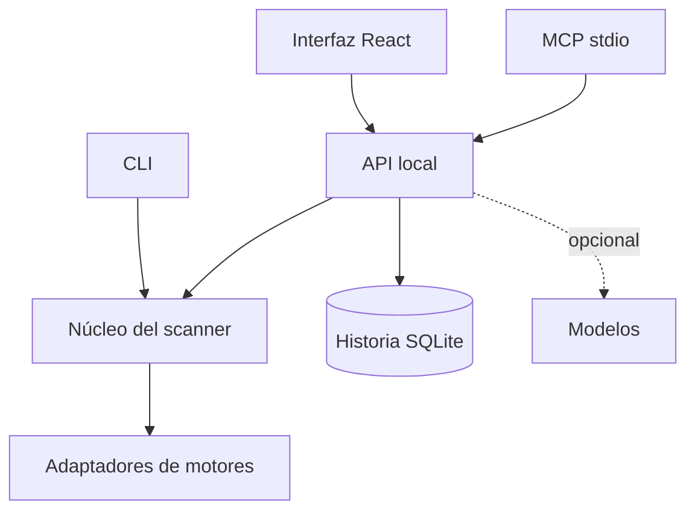

<p align="center">
  
</p>
<h1 align="center">openSeec</h1>

<p align="center">
  <a href="LICENSE"></a>
  
  
  
  
  
</p>

<p align="center"><strong>Seguridad de repositorios con detección local, historia y una investigación adicional opcional.</strong></p>
<p align="center">SAST propio · secretos · dependencias con KEV y EPSS · nada se ejecuta del repo analizado</p>

## En 30 segundos

openSeec revisa un repositorio de código en tu máquina y te dice **qué mirar primero**:

- **Código riesgoso**: inyección de comandos o SQL, rutas armadas con datos del usuario, deserialización insegura.
- **CI e infraestructura**: workflows de GitHub Actions con acciones sin fijar o datos del evento en comandos, y
  Terraform con almacenamiento público o ingreso abierto.
- **Secretos** que quedaron escritos en archivos: contraseñas, tokens, cadenas de conexión.
- **Dependencias vulnerables**: librerías con avisos conocidos, marcando las que se están explotando en el mundo real,
  y la versión que los cerraría todos.

Tres reglas guían todo el producto:

| Regla | Qué significa en la práctica |
|---|---|
| **Nunca ejecuta el repo analizado** | No instala dependencias, no corre builds (MSBuild, `dotnet restore`, `npm`, `go`, `cargo`), tests ni scripts del objetivo. Lee archivos; para C#, Roslyn arma un modelo semántico en memoria sin generar binarios ni cargar ni ejecutar nada del objetivo. |
| **Una señal no es una vulnerabilidad** | Es algo para revisar, con su evidencia. Confirmarla es trabajo de una persona. |
| **Que no aparezca nada no prueba que sea seguro** | Lo que no se pudo revisar se muestra como «no analizado» o «parcial», nunca como limpio. |

## Cómo funciona



1. **Inventario.** Lista qué archivos hay y de qué lenguaje son, respetando límites de tamaño y exclusiones (`.env`,
   dependencias instaladas, enlaces).
2. **Motores locales.** Cuatro herramientas fijas, con versión y hash verificados, corren sobre esos archivos. Son
   las que detectan; nada depende de un modelo de IA.
3. **Señales y cobertura.** Cada hallazgo trae su evidencia, con los secretos tapados. Al lado queda registrado qué
   archivo revisó cada motor y cuál falló o no se inició.
4. **Prioridad e informe.** Primero los paquetes maliciosos; después lo que está en el catálogo CISA KEV de
   explotación activa, y así. El informe se exporta en HTML, JSON y SARIF.
5. **Historia.** Cada corrida se guarda redactada, para comparar con la anterior.

La **investigación con IA** es opcional y va después: propone hipótesis sobre los resultados, pero no decide qué
motor correr ni confirma vulnerabilidades.

## Qué revisa

<picture>
  <source media="(prefers-color-scheme: dark)" srcset="assets/cobertura-lenguajes-oscuro.svg">
  
</picture>

**Cobertura: 88 %** (52 de 59 celdas que aplican). Cuenta una celda «Parcial» o mejor; «Sin medir» no cuenta y «No aplica» sale del total. «Medida»: corpus con verdad o caso real contra un oráculo independiente; en reglas SAST, además, 0 falsos positivos y 0 falsos negativos en un holdout de otro autor. «Parcial»: alcance acotado (reglas sin holdout, chequeo propio de delimitadores o grafo que sobreaproxima). «No analizado» nunca significa «sin riesgos».
Fuente: `src/language_registry.py` y RELEASE-LOCAL; se regenera con `python tools/brand/coverage_chart.py`.

Los cuatro motores, en criollo:

| Motor | Qué busca | Ejemplo | Lo que no hace |
|---|---|---|---|
| **Opengrep 1.33.1** (reglas propias) | Código que lleva un dato del usuario a un lugar peligroso; workflows de CI y Terraform riesgosos | `valor = request.args.get("value")` y después `subprocess.check_call(valor, shell=True)` | Seguir el dato entre archivos |
| **Gitleaks 8.30.1** | Secretos escritos en archivos | `Password=...` en un `appsettings.json` | Verificar con el proveedor si el secreto sirve |
| **OSV-Scanner 2.6.0** (sin red) | Dependencias con avisos conocidos o paquetes maliciosos, y la versión que cierra todos sus avisos | `lodash 4.17.15` en `package-lock.json` | Saber si tu código llega a la parte vulnerable |
| **AST de Python** (propio) | Llamadas directas a `eval` | `eval(texto)` | Alias ni flujo de datos |

Las dependencias se leen del lockfile, sin instalador: `requirements.txt`, uv, Poetry, `package-lock`, pnpm, Yarn,
NuGet, Composer, `go.mod` y `Cargo.lock`. La guía de [.NET](docs/dotnet.md) explica qué archivos aportan evidencia en
esos proyectos.

### Novedades de 0.24

| Qué | Cobertura nueva | Resultado medido |
|---|---|---|
| **Holdout de otro autor** | Reglas de PHP, Go, Rust, GitHub Actions, Terraform, Dockerfile, Compose y Kubernetes (326 casos), y segunda vuelta para Java, Kotlin, Ruby y Objective-C; reglas congeladas y una sola corrida | PHP, Kotlin, GitHub Actions, Terraform, Compose y Kubernetes: 0 falsos positivos y 0 falsos negativos, pasan a «Medida». Go, Rust, Dockerfile, Java, Ruby y Objective-C: 1 o 2 errores, quedan «Sin medir» |
| **Análisis estructural** | Chequeo propio de delimitadores para JavaScript, TypeScript, Java, Kotlin, Swift, Objective-C, Ruby, Vue y Razor; el informe dice si el parser encontró errores | 175/175 contra verdad a mano |
| **Grafo e imports** | Java, Kotlin, Swift, Ruby, Objective-C, Vue y Razor, leyendo `pom.xml`, `build.gradle.kts` y `Package.swift` como texto, sin ejecutar nada | Verdad a mano sin faltantes ni sobrantes; 47/47 aristas en un árbol real |
| **Repos grandes** | Plazo que se adapta al tamaño medido del repo, avance en vivo con archivos, lenguajes y proyectos, porcentaje de Opengrep, y `--exclude` para dejar carpetas afuera (se informan como excluidas, nunca como limpias) | Repo real de 34 336 archivos y muchos lenguajes: termina sin timeout en 1231 s (plazo adaptado 3148 s); con `--exclude` de una carpeta de terceros, 15 360 archivos en 466 s. Opengrep reintenta con 2048 MiB los archivos que se quedan sin memoria (29/29 recuperados) |
| **Investigación por tandas** | Cuando las señales no entran en el contexto de Sol, van en varias tandas en orden fijo; el informe dice cuántas y qué cubrió cada una, nunca recorta en silencio | En ese repo: 2 tandas, 509 de 509 señales cubiertas, 0,04 USD |
| **Roslyn visible** | Si el sello de aislamiento del backend .NET quedó viejo, la app lo dice y cómo renovarlo, en vez de «No ejecutado» | Chequeo de cierre `check_seal.py` |

## Cómo leer los resultados

| Vas a ver | Quiere decir |
|---|---|
| **Señal** | Algo para revisar, con archivo, línea y evidencia. No es una vulnerabilidad confirmada. |
| **Explotada activamente (KEV)** | El CVE del aviso figura en el catálogo de CISA, con la fecha del catálogo. |
| **EPSS** | Probabilidad estimada de que se explote, con su fecha. Se muestra como dato; no reordena. |
| **Desconocido** | Falta el dato (sin CVE, catálogo vencido o inválido). Nunca se lee como «no figura». |
| **Parcial / no analizado** | Un motor falló, se cortó o no tiene reglas para ese lenguaje. El informe nombra los archivos. |
| **Persistente** | La señal estaba también en la corrida anterior comparable. |
| **No comparable** | Cambiaron las herramientas, la cobertura o la base: no se puede decir si algo es nuevo. |

La CLI resume todo en su código de salida: **2** si el análisis quedó incompleto o algo falló, **1** si hay señales,
**0** si no hay señales dentro del alcance. Ningún código garantiza seguridad
(detalle).

## Primeros pasos

Esta guía presupone acceso autorizado a la aplicación. Descargar este repositorio de documentación no instala el producto.

Necesitás Python 3.12 o posterior y Node.js 24 o posterior. Los binarios de los motores y la base de vulnerabilidades
se preparan aparte: clonar el repo no los instala.

**1. Levantar la interfaz** (dos terminales):

```powershell
npm install --prefix frontend
npm run dev --prefix frontend
```

```powershell
python src/web_api.py --history --scan-timeout 300
```

Abrí **http://127.0.0.1:5173/** (la API queda en http://127.0.0.1:8791/).

**2. Analizar un repo tuyo**, autorizando su carpeta al arrancar la API:

```powershell
python src/web_api.py --history --scan-timeout 300 --allow-root D:/ruta/al/repo
```

Guardá la historia y las trazas fuera del repo analizado.

**3. O usar la línea de comandos:**

```powershell
python src/openseec.py engines                                       # qué motores hay
python src/openseec.py scan fixtures/python --json                   # ejemplo propio
python src/openseec.py scan D:/ruta/al/repo --engine all --osv-db <snapshot-local> --timeout 300 --json
```

El plazo por defecto de la CLI es 30 s; en la app se configura en **Configuración → Plazo máximo del análisis**
(plazos).

## Mantener las bases al día

Las vulnerabilidades cambian todos los días. La base se actualiza **aparte del análisis** y cada corrida queda ligada
a la versión que usó:



```powershell
./ops/update-osv.ps1 -Run      # baja OSV, KEV y EPSS, cada uno por separado
./ops/update-osv.ps1 -Status   # versión, fecha y vencimiento de cada base
```

Se puede programar una vez por día con una tarea registrada a mano. Las descargas son de datos públicos: el repo nunca
sale de tu máquina. Más opciones (importar ZIP oficiales, KEV/EPSS a mano) en la
referencia.

## Funciones opcionales

### Análisis incremental

Apagado por defecto. Vuelve a analizar sólo lo que cambió, cuando se puede demostrar que el resultado sería el mismo
que un análisis completo. Lo decide código determinista, nunca un modelo:



Se activa con `--enable-incremental` en el servidor y `incremental: true` en el pedido (CLI:
`scan --incremental --history-dir DIR`). Gitleaks y OSV corren siempre completos. En repos chicos todavía no ahorra
tiempo total (detalle).

### Investigación con IA

Tres roles, todos opcionales y con aviso antes de consultar: **Decision** clasifica, **Luna** propone pasos y **Sol**
investiga. Sus respuestas son datos no confiables: no aplican cambios ni confirman nada. Hoy reciben sólo conteos y
estados, nunca código, rutas, paquetes ni secretos. Cargar la página no llama a ningún modelo; la CLI y la API no los
activan por defecto. Costos, presupuesto y transporte (incluido el límite de proxy) en la
referencia.

### Más herramientas

- **Python P1 experimental** (`--python-p1`): perfiles Flask, Django y FastAPI dentro de un backend WSL propio
  (cómo prepararlo).
- **MCP por stdio** para usar openSeec desde otro agente: `status`, `scan_start` y `get_scan`
  (mcp-local).
- **Laboratorio nivel 0**: reproduce casos sintéticos propios en una copia; no acredita aislamiento
  (detalle).

## Cómo está construido



El código Python vive en `src/` (mapa del repo) y la interfaz en `frontend/`. Hay tres
bases SQLite que nunca se mezclan: la **historia** de corridas, las **trazas** de tiempos y el **historial de
pruebas**. La arquitectura separa el estado actual del objetivo, y el dominio nombra
las entidades del producto.

## Estado

**Release 0.24.0 «Repos grandes y más medido» (2026-10-31)**: seis lenguajes y formatos más pasan un holdout de otro autor
(PHP, Kotlin, GitHub Actions, Terraform, Compose y Kubernetes); análisis estructural y grafo para nueve lenguajes más;
plazo adaptativo, avance en vivo, exclusión de carpetas e investigación por tandas para repos grandes. Cobertura: 88 %.

Antes, **0.23.0 «Más cobertura medida»**: Razor, Swift y Vue medidos; dependencias Maven/Gradle, RubyGems y SwiftPM;
grafo de PHP, Go y Rust.

Cada release registra en RELEASE-LOCAL qué se midió, en qué condición y qué quedó afuera; la app
lo resume en **Novedades**. openSeec no promete una cobertura equivalente a Snyk ni confirma vulnerabilidades con la
respuesta de un modelo.


## Documentación pública

Este repositorio contiene documentación y recursos visuales. Para consultar por acceso a la aplicación o una demostración, contactá a [Ariel Levy](https://github.com/arielelevy).

- [Guía .NET](docs/dotnet.md)

## Licencia

Software, documentación y recursos visuales propios: **licencia propietaria, todos los derechos
reservados**. Su publicación no autoriza el uso, la modificación ni la redistribución.
Consultá [LICENSE](LICENSE) para las condiciones y el contacto. Los componentes y materiales
de terceros conservan sus licencias.
